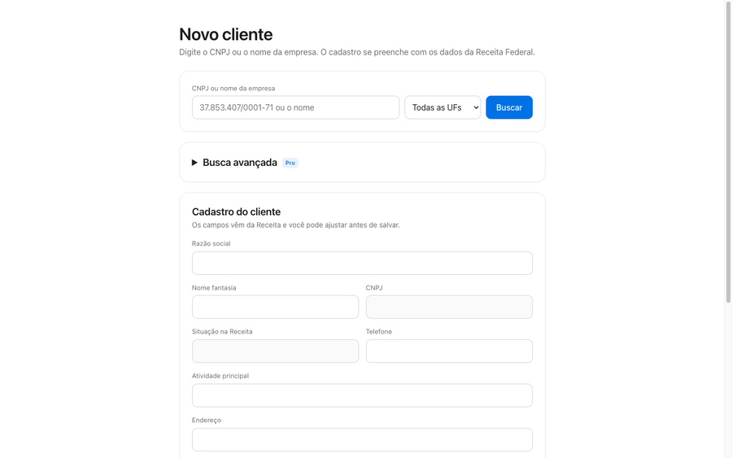

> **Este modelo mudou de casa.** Agora ele é a ferramenta `wortic cnpj` do projeto único
> [developer-wortic/ferramentas-rust](https://github.com/developer-wortic/ferramentas-rust) (pasta `crates/cnpj`), com o
> histórico deste repositório, um binário só para as quatro ferramentas e jsonW em tudo. Este repositório fica
> arquivado, só para leitura.
>
> *This template moved to [developer-wortic/ferramentas-rust](https://github.com/developer-wortic/ferramentas-rust)
> (`wortic cnpj`). This repository is archived.*

# Cadastro de clientes pelo CNPJ em Rust

<!-- GIF -->


Digite o CNPJ ou o nome da empresa e o cadastro se preenche sozinho, com os dados abertos da Receita Federal.

[](LICENSE)

[](https://github.com/developer-wortic/modelo-cadastro-cnpj-rust/actions/workflows/ci.yml)
Cobertura de linhas: 100% (87 testes).

**[Pegar chave](https://cnpj.wortic.com/#planos)** · **[Ver planos](https://cnpj.wortic.com/#planos)**

## Três provas que você pode conferir

1. **Os testes passam.** Rode `cargo test`. A cobertura de linhas da suíte é de 100% (87 testes).
2. **A API responde agora.** `curl https://cnpj.wortic.com/cnpj/37853407000171` devolve a ficha da Wortic: `WORTIC LTDA`, situação `Ativa`.
3. **A base é grande e aberta.** Ela tem 73,8 milhões de estabelecimentos, ativos e inativos, dos dados abertos da Receita Federal. Confira em [cnpj.wortic.com](https://cnpj.wortic.com).

## Início rápido

```sh
git clone https://github.com/developer-wortic/modelo-cadastro-cnpj-rust
cd modelo-cadastro-cnpj-rust
cargo run --release
```

Abra http://127.0.0.1:8080, digite `37.853.407/0001-71` (ou `wortic`) e pronto. Não precisa de cadastro nem de chave.

A API devolve a ficha de um CNPJ em JSON. Para a própria Wortic, o resumo fica assim:

```sh
curl https://cnpj.wortic.com/cnpj/37853407000171
```

```text
WORTIC LTDA - Ativa desde 24/07/2020
CNAE principal: 6202300 (desenvolvimento e licenciamento de programas de computador customizáveis)
Natureza jurídica: Sociedade Empresária Limitada
Porte: Microempresa | Simples: sim | MEI: não
Capital social: R$ 20.000,00
```

O JSON completo traz mais campos, como endereço, CNAEs secundários e a fonte.

## O que vem pronto

- **Ficha completa.** Razão social, nome fantasia, situação e data, CNAE principal e secundários, natureza jurídica, porte, capital social, Simples, MEI, endereço, telefone e e-mail.
- **Sócios.** Nome, qualificação e data de entrada. O CPF sempre aparece mascarado.
- **Fonte na tela.** A ficha cita "Receita Federal, pela Wortic", com o mês da base e a data da consulta.
- **CNPJ conferido antes de consultar.** Os dígitos verificadores são checados no seu servidor, inclusive no CNPJ alfanumérico. Número errado não gasta consulta.
- **Busca por nome, com filtro de UF.** Digite quatro letras ou mais e escolha a empresa na lista.
- **Copiar a ficha.** Copie a ficha de uma empresa em JSON ou em CSV, sem nova consulta.
- **Limites tratados.** A tela trata os erros 402 (limite do plano grátis), 429 e 403, com mensagem clara e tempo de espera.
- **Cache em memória.** A mesma empresa não gasta consulta de novo por um dia. O cache tem tamanho limitado.
- **Ganchos do plano Pro.** Busca avançada (CNAE, UF, cidade, porte, capital), concorrentes e empresas parecidas aparecem na tela. Sem chave, a tela mostra o aviso do plano. Com `WORTIC_API_KEY`, ela chama a API Pro.
- **Um binário só.** A tela vai embutida no executável (`static/index.html`).

## Grátis x com chave

| | Grátis (sem chave) | Dev | Pro |
|---|---|---|---|
| Preço | R$ 0 | R$ 39 por mês | R$ 99 por mês |
| Preço anual | | R$ 390 | R$ 990 |
| Consultas | 60 por minuto e 2.000 por dia, por IP | 100 mil por mês | 1 milhão por mês |
| Ficha, sócios e busca por nome | Sim | Sim | Sim |
| Busca avançada, concorrentes e parecidas | Aviso do plano | Não inclui | Sim, com a Busca Pro |
| Como usar | Nada a fazer | Chave em `WORTIC_API_KEY` | Chave em `WORTIC_API_KEY` |

No plano anual, 12 meses pelo preço de 10: Dev por R$ 390 e Pro por R$ 990.

Planos e compra: [cnpj.wortic.com/#planos](https://cnpj.wortic.com/#planos).


## Quando passar de 60 por minuto

Sem chave, a API aceita 60 consultas por minuto por IP. Acima disso, responde 402 e diz em `retry-after` quantos segundos esperar.

**Cota compartilhada.** Este modelo chama a API sempre do mesmo IP, o do servidor onde ele roda. Por isso, todos os usuários de um modelo publicado dividem o mesmo limite. Não é um limite por pessoa.

**Insistir acima do limite bloqueia o IP.** A API conta cada minuto em que o IP passa do limite. Quando a insistência se repete, o bloqueio cresce:

- Passou do limite 10 vezes: bloqueado por 1 hora (429).
- Depois de 3 bloqueios de 1 hora: o próximo é de 6 horas.
- Depois de 3 bloqueios de 6 horas: o IP é banido de vez (403).

**Em produção, use a chave.** Defina `WORTIC_API_KEY` com a chave do seu plano. Com chave, vale o limite do plano e a escada de bloqueio não se aplica.

**Guarde as respostas.** O modelo guarda a ficha em memória por um dia, com tamanho limitado. A mesma empresa, consultada de novo, não gasta outra consulta.

**Ritmo recomendado: no máximo 1 consulta por segundo.** Se você escreve um laço que consulta muitas empresas, espere 1 segundo entre um pedido e outro.

## Servidor MCP aberto, sem login

A API tem um conector MCP aberto, sem chave, em `https://cnpj.wortic.com/mcp`. Ele tem três ferramentas:

- `consultar_cnpj`: a ficha da empresa, com o CNPJ com ou sem pontuação, inclusive o alfanumérico.
- `listar_socios`: os sócios e administradores, com o CPF mascarado.
- `buscar_empresa`: empresas ativas pelo nome (4 letras ou mais), com UF opcional.

Para ligar em um cliente MCP, como Claude Desktop ou Cursor, use:

```json
{
  "mcpServers": {
    "wortic-cnpj": { "url": "https://cnpj.wortic.com/mcp" }
  }
}
```

Para testar a lista de ferramentas:

```sh
curl -s -X POST https://cnpj.wortic.com/mcp \
  -H 'content-type: application/json' -H 'accept: application/json, text/event-stream' \
  -d '{"jsonrpc":"2.0","id":1,"method":"tools/list"}'
```

O MCP acima é da API. Este modelo não é um servidor MCP. Agentes que leem a API por conta própria podem usar o [llms.txt](https://cnpj.wortic.com/llms.txt). Dentro do Claude e do ChatGPT, o [conector da Wortic](https://wortic.com.br/conectar-ia) traz a mesma consulta.

## Rotas do seu backend

| Rota | O que faz |
|---|---|
| `GET /` | A tela do cadastro |
| `GET /api/empresa/{cnpj}` | Ficha da empresa |
| `GET /api/socios/{cnpj}` | Sócios da empresa |
| `GET /api/empresas?nome=&uf=` | Empresas pelo nome, 4 letras ou mais |

## Ajustes

| Variável | Para quê | Padrão |
|---|---|---|
| `PORTA` | Porta do servidor | `8080` |
| `ENDERECO` | Endereço em que o servidor escuta. Use `0.0.0.0` só atrás de um proxy, e com `WORTIC_API_KEY` | `127.0.0.1` |
| `WORTIC_API_KEY` | Chave do seu plano, para volume acima do uso grátis | sem chave |
| `CADASTRO_CACHE_MAX` | Quantas respostas ficam guardadas em memória; passou disso, sai a mais antiga | `5000` |
| `CADASTRO_API_BASE` | Endereço da API de origem, para um espelho ou um servidor de teste | `https://cnpj.wortic.com` |

## Onde mexer

- **Salvar de verdade:** o botão "Salvar cliente" guarda só na sessão do navegador. Troque o trecho do `submit` em `static/index.html` por um `POST` para o seu banco.
- **Publicar:** `cargo build --release` gera `target/release/cadastro-cnpj`. Ponha atrás do seu proxy com HTTPS.

## Testes

```sh
cargo test
```

Cobertura de linhas: 100% das linhas de `src/`, com 87 testes.

Cada push e cada pull request roda formatação, clippy (com o nível pedantic) e os testes no GitHub Actions. O arquivo está em `.github/workflows/ci.yml`.

## Privacidade e LGPD

- O modelo não grava cadastro em disco. O que você salva fica na sessão do navegador, e o cache some quando o programa para.
- Os dados vêm da Receita Federal, pela Wortic. Podem estar desatualizados, porque a base segue a publicação mensal da Receita.
- O CPF de sócio pessoa física sai sempre mascarado, como a API devolve.
- **Correção ou remoção de dado:** abra uma [issue](https://github.com/developer-wortic/modelo-cadastro-cnpj-rust/issues/new/choose) no modelo "Dado errado" ou "Remoção de dado (LGPD)". Não ponha dado pessoal na issue, porque ela é pública. Para pedido de dado pessoal, use o canal da [página de privacidade](https://cnpj.wortic.com/privacidade).

## Perguntas frequentes

**Como fazer um cadastro de clientes pelo CNPJ em Rust?**
Rode este modelo com `cargo run --release` ou copie `src/api.rs`. Ele consulta `https://cnpj.wortic.com`, confere os dígitos antes e guarda a ficha por um dia.

**A consulta de CNPJ é grátis?**
Sim. Sem cadastro e sem chave, são 60 consultas por minuto e 2.000 por dia, por IP. Os planos pagos começam em R$ 39 por mês.

**Aceita o CNPJ alfanumérico?**
Sim. A conferência dos dígitos em `src/cnpj.rs` segue a regra nova da Receita Federal, com letras nas 12 primeiras posições.

**De onde vêm os dados?**
Dos dados abertos do CNPJ da Receita Federal, pela Wortic. A base tem 73,8 milhões de estabelecimentos.

**A API mostra faturamento ou número de funcionários?**
Não. O cadastro do CNPJ não traz esses dados, e a API não deduz. Faturamento, funcionários e dívidas ficam de fora.

**Dá para ver os sócios?**
Sim. A rota de sócios traz nome, qualificação, data de entrada e faixa etária. O CPF sai sempre mascarado.

**Posso usar o modelo em produção sem chave?**
Não é o ideal. Sem chave, todos os usuários do modelo dividem o mesmo IP e o mesmo limite de 60 por minuto. Em produção, use `WORTIC_API_KEY`.

**Como consultar muitas empresas sem ser bloqueado?**
Espere 1 segundo entre uma consulta e outra e não repita CNPJ. Com chave, vale o limite do seu plano. Veja "Quando passar de 60 por minuto".

**Tem exemplo em outras linguagens?**
Sim. A [documentação](https://cnpj.wortic.com/docs) tem exemplos prontos em 10 linguagens, de cURL a Swift, e em 13 frameworks.

**Tem servidor MCP para agentes de IA?**
Sim, em `https://cnpj.wortic.com/mcp`, sem login. Tem três ferramentas: `consultar_cnpj`, `listar_socios` e `buscar_empresa`.

**Como trato os erros 402, 429 e 403?**
O 402 é o limite do plano grátis: espere o `retry-after` ou assine um plano. O 429 é bloqueio por insistir acima do limite. O 403 é IP banido. A tela mostra a mensagem e o tempo de espera.

**Posso usar o código no meu sistema comercial?**
Sim. O código é MIT: use, mude e venda o sistema feito a partir dele.

## Contribuir e segurança

Veja [CONTRIBUTING.md](CONTRIBUTING.md) para contribuir e [SECURITY.md](SECURITY.md) para relatar falha de segurança.

## English

**Customer registry by CNPJ in Rust.** A ready-to-run form that fills itself from a Brazilian company's CNPJ or name, using the open Receita Federal data through the free [cnpj.wortic.com](https://cnpj.wortic.com) API (73.8 million establishments, active and inactive). One binary with the page embedded, check digits validated locally (alphanumeric CNPJ included), a one-day in-memory cache, and handling of the 402, 429 and 403 responses. Without a key, the free use is 60 requests per minute per IP, shared by every user of a published copy, so use `WORTIC_API_KEY` in production. Run `cargo run --release`, then open http://127.0.0.1:8080. MIT licensed.

## Licença

MIT. Use, mude e venda o seu sistema feito a partir deste modelo. Texto completo em [LICENSE](LICENSE).

---

**[Pegar chave](https://cnpj.wortic.com/#planos)** · **[Ver planos](https://cnpj.wortic.com/#planos)**
